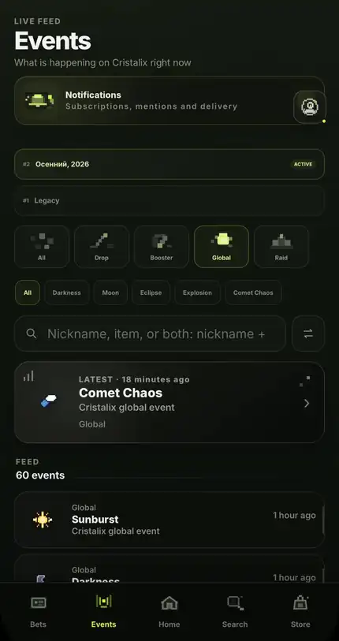
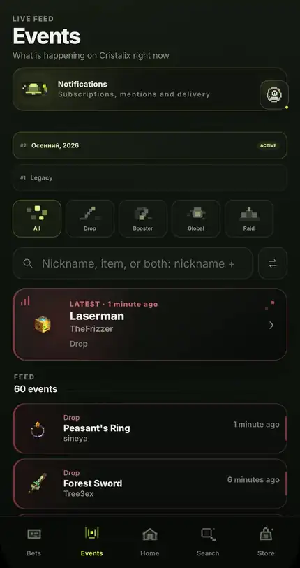
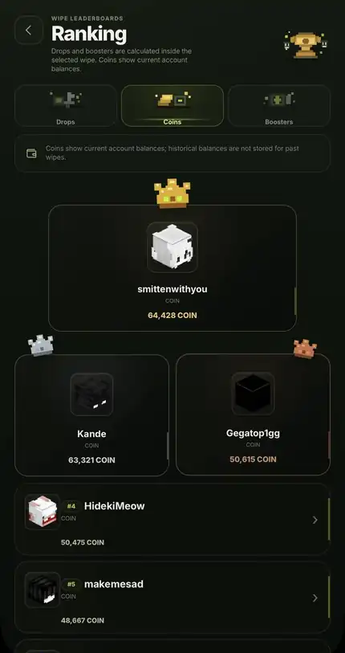
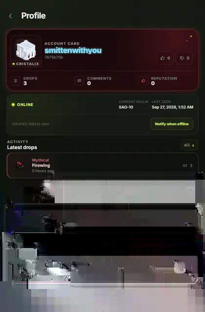
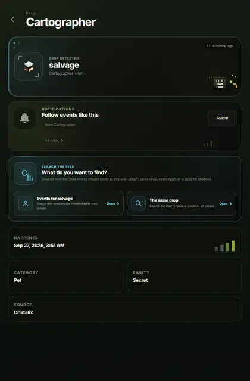
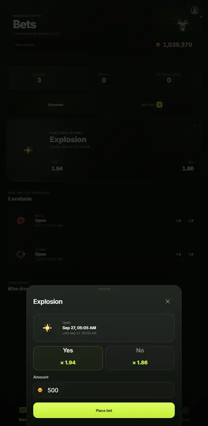
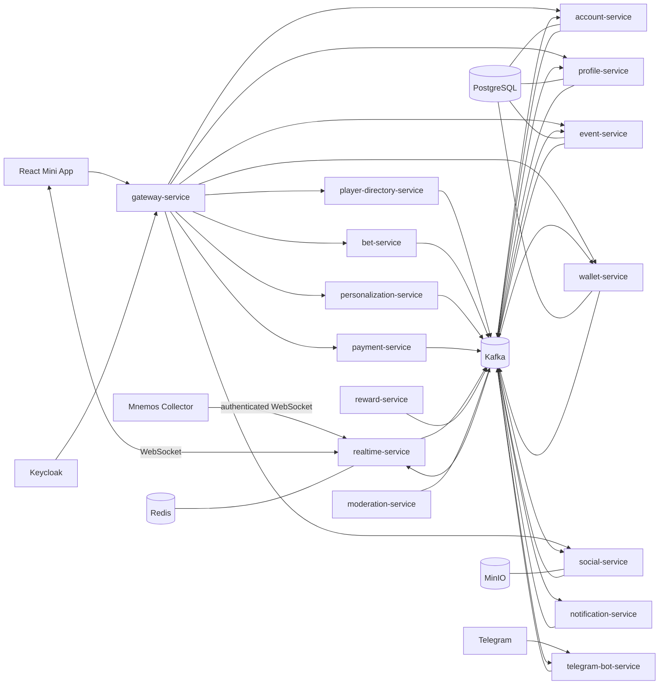
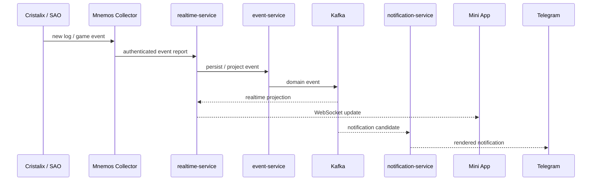

<div align="center">

# Mnemos

### Event-driven platform for Cristalix / SAO activity, social features, realtime state and account tooling

**Kotlin · Spring Boot · Kafka · PostgreSQL · Redis · Keycloak · React · TypeScript · WebSocket · Docker**

</div>

---

## Overview

Mnemos is a multi-service platform built around live Cristalix / SAO data and the workflows that grow around it: event tracking, player presence, accounts and teams, notifications, rewards, economy, social features, personalization, bets and Telegram integration.

The project is intentionally split into bounded services rather than one monolith. Services communicate through explicit contracts, Kafka events and HTTP where synchronous reads are appropriate. Shared infrastructure provides security, messaging, inbox/outbox processing and common web behavior without collapsing domain boundaries.

The frontend is a React + TypeScript mini-app designed as a real product surface, not an admin shell. It receives realtime updates from the backend and exposes account management, event discovery, player profiles, wallet flows and other domain features.

---

## Product

Mnemos combines Cristalix/SAO event tracking, player activity, account management and the in-app economy in a mobile interface.

<p align="center">
  
</p>
<p align="center"><sub>Home · account, events, rewards and team</sub></p>

<table>
<tr>
<td width="50%"></td>
<td width="50%"></td>
</tr>
<tr>
<td align="center"><b>Global events</b><br/>Current server events, wipe selection and filtering.</td>
<td align="center"><b>Drops</b><br/>Recent item drops, player names and event search.</td>
</tr>
</table>

<table>
<tr>
<td width="50%"></td>
<td width="50%"></td>
</tr>
<tr>
<td align="center"><b>Rankings</b><br/>Wipe-scoped leaderboards for coins, drops and boosters.</td>
<td align="center"><b>Player profiles</b><br/>Presence, SAO realm and recent activity.</td>
</tr>
</table>

<p align="center">
  
</p>
<p align="center"><sub>Wallet · balances, coin exchange and transaction history</sub></p>

<details>
<summary><b>More screens: event details and bets</b></summary>
<br/>
<table><tr>
<td width="50%"></td>
<td width="50%"></td>
</tr></table>
</details>

---

## What Mnemos currently covers

- **Accounts & teams** — account membership, roles, permissions and invites.
- **Live events** — item drops, boosters, global events and raids with search, filters, wipe scoping and realtime updates.
- **Player directory** — Cristalix identity resolution, online presence, SAO realm projection and presence subscriptions.
- **Profiles & social** — public profiles, reactions, comments, recent activity and social projections.
- **Notifications** — event subscriptions, delivery rules and Telegram notification rendering.
- **Rewards** — daily rewards and reward-oriented account flows.
- **Wallet & payments** — account balances, PRIME / COIN flows and payment integration.
- **Bets** — rounds, races, positions and administrative management.
- **Personalization** — profile appearance, presets and review-oriented customization flows.
- **Moderation** — moderation boundaries and administrative operations.
- **Guides** — SAO-oriented guide content delivered through the mini-app.
- **Realtime** — authenticated WebSocket sessions and server-pushed domain updates.

---

## Architecture



The diagram is intentionally conceptual: Mnemos keeps each domain behind its own application boundary and uses shared contracts instead of a shared domain model.

### Backend modules

The Gradle build currently includes these application services:

```text
account-service             wallet-service
event-service               notification-service
reward-service              bet-service
moderation-service          gateway-service
realtime-service            personalization-service
social-service              profile-service
player-directory-service    payment-service
telegram-bot-service
```

Reusable platform modules include:

```text
common-core       common-web       security-starter
messaging-core    kafka-starter    outbox-starter
inbox-starter
```

Service-to-service event schemas live in dedicated contract modules so producers and consumers share transport contracts without sharing service internals.

---

## Event flow

A common path through the system looks like this:



Collector delivery is deliberately separate from the backend domain services. The collector detects and parses local game activity, while Mnemos owns persistence, projection, subscriptions and product behavior.

---

## Reliability patterns

Mnemos uses explicit reliability mechanisms instead of treating Kafka delivery as infallible:

- transactional **outbox** publishing;
- consumer-side **inbox / deduplication** support;
- versioned contract modules;
- message authentication and Kafka transport hardening;
- bounded synchronous HTTP calls where a request/response dependency is actually required;
- retry / backoff policies around external systems;
- operational metrics for player-directory tracking, presence freshness and upstream quota pressure.

The repository also contains runtime verification scripts for Kafka, Redis, Keycloak, MinIO, Compose isolation and service authorization boundaries.

---

## Authentication & security

- **Keycloak** is the identity boundary for the web application.
- A custom **Telegram authenticator** lives under `keycloak-extensions/telegram-authenticator`.
- Backend services use Spring Security / resource-server boundaries.
- Kafka communication has explicit signing / trust configuration and transport-security verification.
- Production deployment workflows validate the exact source revision before deployment.

---

## Frontend

The mini-app lives in `apps/mini-app` and is built with:

- React 19
- TypeScript
- Vite
- i18next / react-i18next
- Framer Motion
- Vitest + Testing Library
- ESLint + Prettier

The UI is localized and receives realtime domain updates through the WebSocket layer.

---

## Mnemos Collector

[Mnemos Collector](https://github.com/knliiss/Mnemos-Collector) is the companion desktop client written in Rust.

It discovers the running Cristalix session, follows `latest.log`, recognizes supported SAO context, parses events, persists pending reports locally and sends them to Mnemos over an authenticated realtime connection. The collector also handles provisioning, secure credential storage, diagnostics and signed self-updates.

Keeping the collector in a separate repository makes the trust and deployment boundary explicit: local observation code can evolve independently from the backend platform.

---

## Repository layout

```text
apps/                   deployable backend services + mini-app
contracts/              inter-service event / API contracts
libraries/              shared platform libraries and starters
keycloak-extensions/    custom Keycloak integrations
infrastructure/         Compose, Kafka, PostgreSQL, Redis, MinIO, Keycloak
scripts/                verification and operational scripts
docs/                   operational documentation and runbooks
```

---

## Development

### Backend

Requirements:

- JDK 21+
- Docker with Compose

Build and test the Gradle workspace:

```bash
./gradlew clean build
```

Infrastructure is split into composable files under `infrastructure/compose/` rather than a single opaque stack file. Environment values are validated by repository scripts before CI or production use.

### Mini-app

Requirements:

- Node.js version from `apps/mini-app/.node-version`

```bash
cd apps/mini-app
npm ci
npm run verify
```

For local development:

```bash
npm run dev
```

---

## CI & delivery

The repository has separate workflows for:

- backend verification;
- mini-app verification;
- full-stack smoke tests;
- Cloudflare Pages deployment;
- production service image builds and targeted backend deployment;
- runtime-policy and branch-hygiene checks.

Frontend production deployment is revision-pinned: the Pages workflow validates that the requested source commit belongs to trusted `master` history before building and deploying the immutable artifact.

---

## Tech stack

| Area | Technology |
| --- | --- |
| Backend | Kotlin 2.4, Spring Boot 4.1, Spring Security, Spring WebSocket |
| Messaging | Apache Kafka, shared contracts, inbox/outbox starters |
| Identity | Keycloak, custom Telegram authenticator |
| Data | PostgreSQL, Redis, MinIO |
| Frontend | React 19, TypeScript, Vite, i18next, Framer Motion |
| Client | Rust-based Mnemos Collector |
| Infrastructure | Docker Compose, GitHub Actions, Cloudflare Pages |
| Testing | Spring Boot Test, Mockito Kotlin, Vitest, Testing Library |

---

<div align="center">

**Mnemos is an actively developed system.** The architecture and product surface continue to evolve as real runtime behavior exposes better boundaries and new requirements.

</div>
